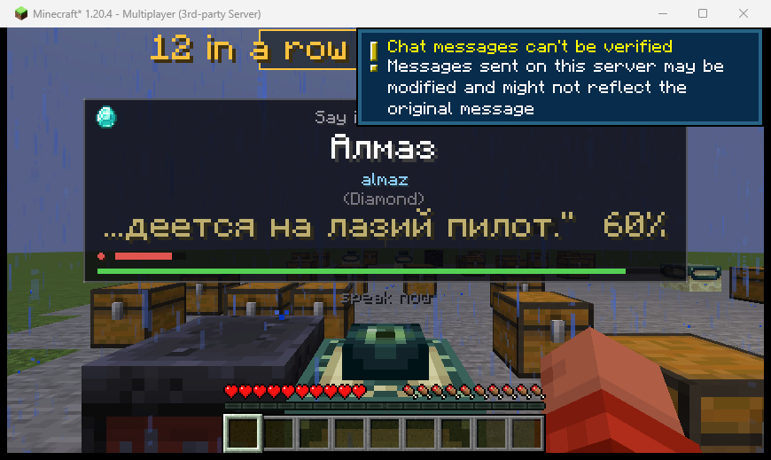

# leximine-mod

Fabric mod for Minecraft **1.20.4**. Items you pick up are held in limbo until
you say their name in the language you are learning; a local
[lingua-stt-backend](https://github.com/optumesto/lingua-stt-backend) decides whether you got it right.
Recognition runs on your own machine: microphone audio is decoded in memory,
never uploaded and never written to disk.

> **Installing it to play?** → download the zip from the
> **[latest release](https://github.com/optumesto/leximine-mod/releases/latest)**
> and follow **[INSTALL.md](INSTALL.md)**. Requirements,
> one-click setup, a `check-setup.cmd` that names whatever is missing, and an
> exact account of the three things that do use the network. This file is the
> design record: what each feature does and why it is built the way it is.
>
> **Making a release?** `scripts\make_release.ps1 -Zip` stages both halves
> into `dist\Leximine-<version>\` (860 KB) and zips it (475 KB). It installs
> with no JDK, no Gradle and no source.

**It plays.** Pick an item up, it is held in limbo, the overlay shows the word
in the language you are learning, you say it out loud, and the item is yours or
it is gone.

Everything else grew out of that loop, each described in its own section
below:

| | |
|---|---|
| [Any language, and knowing what to say](#any-language-and-knowing-what-to-say) | pick from ~140 languages; a romanized reading, and a key to hear it |
| [How much you have to say](#how-much-you-have-to-say) | what you are asked scales with the item: noun, full name, whole sentence |
| [The live transcript](#the-live-transcript) | what the backend is hearing, as you speak, settled words bright and the tail dimmed |
| [What a miss costs](#what-a-miss-costs--the-lotto) | past tier 1, losing the item is not the only consequence |
| [Streaks](#streaks) | a run counter, and past ten a slip costs a tier more |
| [Doors and chests that quiz you](#doors-and-chests-that-quiz-you) | spaced repetition on the words you keep getting wrong |
| [Asking a villager for it](#asking-a-villager-for-it) | negotiate a trade in a sentence, judged by a local language model |
| [The Nether wants a reason](#the-nether-wants-a-reason) | one sentence you compose yourself before the portal lights |
| [The End has a toll](#the-end-has-a-toll) | all twelve eyes of ender, argued into their frames at the top tier |



The overlay above is a real capture mid-utterance: the word, the English gloss,
a live transcript of what the backend is hearing with its similarity score, a
recording indicator with a level meter, and the countdown.

### Phase 4, verified end to end

The speech path is tested with nobody in the room.
`-Dleximine.fakeMic=<wav>` substitutes a file for the microphone *inside the
mod*, so the bytes still travel the real route: `AudioCapture` → websocket →
faster-whisper → fuzzy matcher → verdict packet → inventory.

```
SCENARIO 3  correct word spoken  (diamante.wav)
  server: challenge 3 begun for Player232: item.minecraft.diamond x1
  server: challenge 3 resolved: success
  inventory holds 1 x minecraft:diamond (want 1)
  client: Speech verdict for challenge 3: success (early), heard "Diamante" at 100

SCENARIO 4  wrong word spoken  (wrong.wav)
  server: challenge 4 begun for Player144: item.minecraft.diamond x1
  server: challenge 4 resolved: fail
  inventory holds 0 x minecraft:diamond (want 0)
  client: Speech verdict for challenge 4: fail (low_score), heard "Elefante Sandwich" at 50
```

The transcript assertion is the one that matters. Without it a "success" could
just be the fail-open path granting the item because the backend was never
reached — which would make the test prove nothing about speech. `(early)` means
the backend passed it on a speculative partial pass, before the clip had even
finished playing.

### Phase 3, verified end to end

`scripts/e2e_test.py` boots a dedicated server and an auto-connecting client,
then drives the game over RCON — no keyboard, no menus. It asserts against
real game state (`clear <player> <item> 0` counts without removing), not just
log lines:

```
SCENARIO 1  backend up, let the clock run out
  server: challenge 1 begun for Player557: item.minecraft.diamond x1
  server: challenge 1 resolved: fail
  inventory holds 0 x minecraft:diamond (want 0)

SCENARIO 2  backend unreachable
  server: challenge 2 begun for Player962: item.minecraft.diamond x1
  server: challenge 2 resolved: success
  inventory holds 1 x minecraft:diamond (want 1)

ALL CHECKS PASSED
```

Between them those cover both verdict paths without simulating a keypress:
scenario 1 is the timeout, scenario 2 is the fail-open that grants the item
when the speech backend is down. The screenshot above came from
`--hud-shot`, which raises one long challenge and captures the window.

### Phase 2, verified working

`gradlew build` succeeds (16m 25s on the first run, which downloads and
decompiles Minecraft; seconds after that). `gradlew runClient` launches 1.20.4
and the game log shows the whole chain:

```
    - leximine 0.1.0
[Render thread/INFO] (leximine) Leximine 0.1.0 loaded (common)
[Render thread/INFO] (leximine) Leximine 0.1.0 loaded (client)
[leximine-backend-probe/INFO] (leximine) Probing STT backend at ws://127.0.0.1:8760/ws
[WebSocketConnectReadThread-75/INFO] (leximine) Backend connected (HTTP 101)
[WebSocketConnectReadThread-75/INFO] (leximine) Backend ready=true model=small device=cuda language=es_es threshold=80
```

That last line is the one that matters: the bundled `Java-WebSocket` resolved
at runtime from the nested jar, the socket upgraded, and the Python backend's
`hello` frame parsed — so the phase 4 bridge has nothing left to discover
about the transport.

---

## Installing it into Minecraft

```powershell
install-mod.cmd            # or setup.cmd in the backend repo, which runs both halves
install-mod.cmd -Uninstall
```

This creates a **Leximine** profile in the Minecraft launcher with its own
game directory at `%APPDATA%\.minecraft\leximine`, puts the mod and Fabric
API in that profile's `mods` folder, and leaves every other profile alone.

**It deliberately does not use `%APPDATA%\.minecraft\mods`.** That folder is
shared by every Fabric profile — this machine already has a 1.21.11 mod in it,
and adding a 1.20.4 mod alongside it would make both profiles fail on launch
with dependency errors. A separate game directory is the only way the two can
coexist, and it also keeps Leximine's worlds separate from your others.

Fabric API is downloaded from Modrinth on first install (2 MB) and checked
against its published SHA-1. Nothing else is fetched.

`launcher_profiles.json` is backed up to
`launcher_profiles.json.leximine-backup` before being touched, re-read after
writing, and rolled back automatically if the result does not parse. Re-run the
installer after a rebuild to push the new jar.

### Verified

Installing on this machine took the launcher from 8 profiles to 9 with none
lost and none modified. The **production jar** — the remapped one, not the dev
build — was then booted on a real Fabric 1.20.4 dedicated server with the
installed Fabric API:

```
    - leximine 0.1.0
[main/INFO]: Leximine 0.1.0 loaded (common), timeout 6000 ms, per-item cooldown 300s
[Server thread/INFO]: Done (1.518s)!
```

That matters because a mixin can work in dev and fail in production if its
refmap is wrong. `leximine.mixins.json` is `required: true` with
`defaultRequire: 1`, so a mixin that failed to apply would crash startup
instead of silently doing nothing — it didn't, which means the injection into
`ItemEntity.onPlayerCollision` resolved against production mappings too.

---

## Building

```powershell
cd Z:\leximine-mod
.\gradlew.bat build        # jar lands in build/libs/
.\gradlew.bat runClient    # launches 1.20.4 with the mod loaded
```

No `JAVA_HOME` or PATH setup needed — see the JDK note below.

## Why these versions

| | | |
|---|---|---|
| Minecraft | 1.20.4 | already installed here, with `fabric-loader-0.18.6-1.20.4` |
| Loom | 1.6-SNAPSHOT | the line contemporary with 1.20.4 |
| Gradle | 8.6 | what Loom 1.6 supports |
| Yarn | 1.20.4+build.3 | |
| Fabric API | 0.97.3+1.20.4 | last release for 1.20.4 |
| Java | 21 (Temurin) | compiles to release 17 |

**Do not copy the versions off fabricmc.net/develop.** That page now serves
Loom 1.19, which refuses to run on anything below a **Java 25** JVM:

```
> Could not resolve net.fabricmc:fabric-loom:1.19.3
  > Dependency requires at least JVM runtime version 25. This build uses a Java 21 JVM.
```

Installing JDK 25 to satisfy it would mean `runClient` launching Minecraft
1.20.4 on a JVM released two years after the game — so the fix is an older
Loom, not a newer Java.

**Yarn, not Mojang's official mappings.** The current Fabric template uses
`loom.officialMojangMappings()`. Yarn is used here instead because essentially
all Fabric documentation and community code is written against it: the method
this mod is built around is `PlayerInventory.insertStack` in Yarn and
`Inventory.add` in Mojang names. Easier to read, and far easier to search for.

## The JDK is pinned per-project

This machine had **only Java 8** installed (`1.8.0_301`), which is first on
PATH and may well be there for something else. Rather than reorder PATH or
repoint `JAVA_HOME`, Temurin 21 was installed alongside and this one project
points at it, in `gradle.properties`:

```properties
org.gradle.java.home=C:/Program Files/Eclipse Adoptium/jdk-21.0.12.101-hotspot
```

Forward slashes are deliberate: in a `.properties` file a backslash is an
escape character. If you later move or upgrade the JDK, this is the one line
to change.

---

## Layout, and why it is split in two

```
src/main/      common    -- loaded on client AND dedicated server
  java/dev/mettle/leximine/
    Leximine.java          common entrypoint
    LeximineMeta.java      version/dev-env lookup from loader metadata
    mixin/                    (phase 3: pickup interception)
  resources/
    fabric.mod.json
    leximine.mixins.json

src/client/    client-only -- never loaded on a server
  java/dev/mettle/leximine/client/
    LeximineClient.java    client entrypoint
    LexClientConfig.java   backend URL
    BackendProbe.java         startup handshake check
    mixin/                    (phase 3: HUD overlay)
  resources/
    leximine.client.mixins.json
```

`splitEnvironmentSourceSets()` is not housekeeping here. **Item pickup is
server-authoritative**, so the interception has to live in `src/main` — a
client-only mod cannot stop the server from putting the item in your
inventory, and would desync the moment you played on a real server. Meanwhile
the HUD and the microphone must never load server-side. The split makes a
mistake in either direction a compile error instead of a crash.

In single-player this all still runs in one process (the integrated server), so
nothing extra is needed to play.

## Talking to the backend

`Java-WebSocket` is bundled into the jar with Loom's `include`, so the mod
works from a plain `mods/` folder with no extra downloads. Minecraft already
ships slf4j and gson, which cover the rest.

The backend owns the dictionary, the timer and the difficulty — the mod sends
a translation key and microphone audio and gets back `success` or `fail`. That
means changing target language is a backend restart, not a mod rebuild. The
wire format is in [`PROTOCOL.md`](https://github.com/optumesto/lingua-stt-backend/blob/main/PROTOCOL.md).

`BackendProbe` runs once at client startup, reads the backend's `hello` frame
and logs the model, device and readiness. It exists to catch the three things
that would otherwise only surface mid-game: the bundled websocket jar missing
from the runtime classpath, the backend not running, and the backend running
with its model still loading. It is throwaway — phase 4 replaces it with the
persistent connection that actually plays the game.

Point it somewhere else with `-Dleximine.backend=ws://host:port/ws`.

Start the backend first:

```powershell
cd Z:\lingua-stt-backend; .\run.ps1
```

## How the loop works

```
   player walks over an item
            |
   [server] ItemEntityMixin cancels the vanilla pickup, LimboManager
            takes the stack, nothing is in any inventory now
            |
            |--- challenge_start (id, stack, translation key, timeout) --->
            |
   [client] opens a challenge on the speech backend, draws the word it
            sends back, opens the microphone, streams 16 kHz PCM, and
            shows the running transcript
            |
            |<--- challenge_resolve (id, success) ---------------------
            |
   [server] success -> insertStack + level-up chime
            fail    -> stack discarded + fire-extinguish fizzle
            |
            |--- challenge_end (id, success) ------------------------->
```

The server keeps its own deadline with a grace margin and fails the challenge
if no verdict ever arrives, so a crashed client cannot leave an item stuck in
limbo forever. On disconnect the item is **dropped back into the world** rather
than destroyed — losing a diamond to a dropped connection is not part of the
game.

## The microphone

Captured as 16 kHz mono signed-16-bit little-endian — exactly what the backend
asks for, so nothing resamples anywhere in the chain. The line is **only open
while a challenge is on screen** and is closed the instant one resolves; the
mod never holds the microphone in the background.

By default it opens on its own when the word appears, because the game is
already a five-second timer and asking the player to hold a key as well is one
thing too many. Set `-Dleximine.pushToTalk=true` for hold-`V`-to-speak.

Available input devices are listed in the log at startup. Pick one with
`-Dleximine.micDevice=<substring of its name>`.

The level meter is not decoration: "is it even hearing me" is the first
question when a challenge fails, and silence looks identical to a wrong answer
without it. The running transcript answers the second question — whether you
said the wrong word or were simply misheard.

### Fail open, always

Every failure path grants the item rather than destroying it:

| situation | what happens |
|---|---|
| backend not running | granted, with a message |
| backend has no translation | granted (`grantUnknown`) |
| no working microphone | granted, warned once |
| socket drops mid-challenge | granted |
| backend never answers `end` | failed after a 1.5 s grace |

A language tool that eats your diamonds because a Python process was not
running is worse than one that occasionally gives a word away.

## Settings

In game, no restart needed:

```
/leximine                        show everything
/leximine set language fr_fr     any Minecraft language code
/leximine set frequency 10m      always | 5m | 10m | 30m | 1h | 6h | 1d | once
/leximine set timeout 8          seconds to answer
/leximine set difficulty strict  lenient | normal | strict
/leximine set crafting false     stop asking on crafted items
/leximine set untilCorrect false
/leximine set pushToTalk true    hold V instead of the mic opening itself
/leximine set pronunciation false   no spoken example after a miss
/leximine set stream true        big live transcript, for an audience
/leximine set tiers false        always ask for the plain noun
/leximine set punishment mob     none | effects | mob | tnt | both
/leximine set review true        doors and chests quiz you
/leximine set reviewCooldown 300 seconds between those
/leximine set negotiate true     villagers want to be asked first
```

They live in `config/leximine.json` inside the profile's game directory, so
you can edit them there too. These need no cheats — changing your own
difficulty is not a cheat. Only `/leximine test` does, because it grants an
item.

### How often you get asked

**The timer only ever starts when you say a word correctly.** Get it wrong and
you are asked again the next time you pick that item up, however the frequency
is set. That is what `untilCorrect` means, and it is on by default.

| frequency | |
|---|---|
| `always` | every single time, even after you get it right |
| `5m` … `1d` | that long after a correct answer before asking again |
| `once` | learn each word once, then never again |

There is also a fixed ~2.5 s gap between any two challenges. Mining drops a
pile of items at once, and without it one miss would fire a new challenge on
the very next tick as the next item lands.

### How much you have to say

What you are asked for scales with how valuable the item is:

| tier | items | prompt |
|---|---|---|
| 1 | wood, stone, dirt, leather | `Pico` |
| 2 | iron, gold, copper, emerald | `Espada de hierro` |
| 3 | diamond, netherite, elytra | `Estoy fabricando una espada de diamante` |

Tools and armour are read from their material directly; everything else is
matched on its item id and only then falls back to rarity, because rarity
alone puts a diamond and a lump of dirt in the same bucket. The timer scales
too — a five-second window is generous for "Pico" and unreasonable for a
sentence. `/leximine set tiers false` goes back to plain nouns throughout.

Tier 3 picks its frame from what you were doing: **"Estoy fabricando…"** when
you craft, **"He encontrado…"** when you pick something up.

Two limits are reported rather than faked:

* **Tier 1 can only shorten a name built as noun + connector + material.**
  "Espada de hierro" cuts to "Espada", but German compounds
  (`Diamantschwert`) are one word and stay whole.
* **Tier 3 only writes sentences for languages with a phrase pack** — Spanish
  so far. The article has to be right: "un espada" is wrong and teaching it
  would be worse than not having the feature, and French gender is not
  reliably inferable from word endings. Everything else falls back to tier 2
  and says so.

The vocabulary list records the **item name**, not the sentence: "Estoy
fabricando una espada de diamante" is not a vocabulary entry.

### Recording it

A few things worth knowing before you hit record:

* **`/leximine set stream true`** draws the live transcript at double size
  for a downscaled video, and widens the panel to match.
* **`/lex force <tier> <id>`** puppets the lotto — skips the speech check,
  takes the held item, and lands on the penalty you name. Cheats-only, so it
  works in the installed profile.
* **`/lex rig <penalty>`** is the one to use on camera. It fakes nothing:
  you play the challenge, open the mic and genuinely fumble the word, and it
  only decides what the wheel lands on when you do. Fires **once** and is then
  spent, so the next take rolls honestly. `/lex rig` on its own says what is
  loaded, `/lex rig off` clears it, and `/lex settings` shows it in
  yellow while it is armed — a rig you set an hour ago and forgot reads as the
  lotto being broken when it finally lands.
* **The progress rung shows in the panel corner** as `lvl 0`–`lvl 3`, and the
  prompts visibly get harder as it climbs. To demonstrate that without saying
  120 words first, seed it: `python scripts\seed_level.py 3` in the backend
  folder, then restart it.
* The panel is capped at three fifths of the screen width (four fifths in
  stream mode). A tier-4 sentence at level 3 — the longest thing the system
  can ask for — sits at about half.
* The *"chat messages can't be verified"* banner in this repo's screenshots
  is a multiplayer artifact of the test rig. It does not appear in the
  single-player Leximine profile.

### What a miss costs — the lotto

Losing the item is unconditional. On top of that the server rolls: **a 50%
chance of one of five penalties** drawn from that item's tier, so any single
penalty is a 10% event and a miss is a coin flip.

This was 20% (4% per payload) until 2026-11-02, on the reasoning that a
punishment which fires every time is a tax you learn to ignore while one that
fires occasionally is a threat you keep thinking about. That reasoning is about
*playing* the mod, and it loses to a different one about *filming* it: in the
first recorded episode the system was set up three times, deliberately failed
once to demonstrate it, rolled safe, and the video ended up explaining to the
audience why nothing had happened. A threat the camera never sees is not a
threat. Half is still not a tax, and `/lex rig` exists for the takes where
the roll has to land.

**You watch it being decided.** The outcome is rolled the instant you miss, but
instead of landing immediately a slot machine appears and spends two seconds
cycling through the five names for that tier before locking onto the answer:

```
            rolling...
          Hunger Pangs          <- grey, cycling every 3 ticks

            THE ITCH            <- red, locked, payload lands now
```

A safe roll locks onto **SAFE** in green. You are deliberately *not* frozen
while it spins — running somewhere safer is a reasonable reaction to a wheel
that might land on a horde, and it genuinely helps, because the payload reads
where you are when it fires rather than where you were when it was rolled.

**Tier 1 — the nuisance lotto** (wood, stone, leather):

| | |
|---|---|
| The Sabotage | a poisonous potato, dead bush or dirt, in place of what you lost |
| Hunger Pangs | Hunger II for 5 s |
| Butterfingers | whatever you were holding is flung across the floor |
| Fright Night | a creeper hiss or cave ambience, right next to you, meaning nothing |
| The Itch | three silverfish |

**Tier 2 — physical danger** (iron, gold, copper, emerald): nausea and
something undead · three fires at your feet · flung backwards and slowed ·
a piece of armour taken off you and thrown ten blocks · three cave spiders.

**Tier 3 — lethal** (diamond, netherite): blindness and a horde of eleven ·
primed TNT while blind and slow · a 1×1 iron cage with an angry golem outside
it · a lava source at your feet · **sensory deprivation** — darkness, mining
fatigue III, three phantoms, and the rest of your day taken: the clock jumps
to midnight. That last part is not only mood. Phantoms burn in daylight, so
without it the three of them were a real threat only if it already happened
to be dark. It only ever moves the clock forward, and only when it is
actually daytime.

The cage is the **full ring** — all eight neighbours including the diagonals,
at both head and foot height, plus a ceiling, and a floor if you were stood
over a hole. Seventeen bars. Only the four cardinal sides looks like a cage
and is not one: a player is 0.6 blocks wide and walks straight out through an
open corner.

It holds for five seconds and then comes apart, one bar a second in a random
order — so somewhere between twenty-two seconds and whenever a gap happens to
open on your side. Without the decay it is not a punishment but a softlock:
caught without a pickaxe there is no way out of iron bars at all. Bars only
vanish if they are still bars, so anything you build in their place is yours
to keep.

**Tier 4 — catastrophic** (nether star, dragon egg, elytra, beacon): a wither ·
150 blocks straight up · cursed armour, Bad Omen V and vexes · 5,000 blocks
away in a random direction · a three-block sphere of the world simply removed.

> **On Peaceful, nine of the twenty do nothing.** The game discards hostile
> mobs on their first tick, so the silverfish, zombies, creepers, cave
> spiders, phantoms, vexes and the wither all vanish before you see them. The
> iron golem survives, being neutral. Play on Easy or above if you want the
> matrix intact.

`/leximine set punishment none` turns the whole thing off. Some of the
higher-tier rolls **damage terrain** — missing a word near your base can take a
bite out of it.

#### Testing it

A 10%-per-payload event is not something you can test by waiting:

```powershell
# On camera: load the next GENUINE miss. No speech check is skipped -- you
# still have to say the word wrong. Fires once, then the dice are back.
/lex rig T3_THE_PANIC_ROOM
/lex rig SAFE             # load the 50% case
/lex rig                  # what is loaded?
/lex rig off              # clear it without firing

# B-roll: skip the speech check, take the held item, land on what you name.
# Cheats-only rather than dev-only, so it works in the installed profile.
/lex force 3 2            # tier 3, penalty 2 -> The Panic Room
/leximine testlotto T1_THE_ITCH
/leximine testlotto SAFE

# or make every miss land, and force which one
gradlew runServer -PlexLottoChance=100 -PlexPenalty=T1_BUTTERFINGERS

python scripts\e2e_test.py --lotto        # all five, asserted in the world
python scripts\e2e_test.py --lotto-shot   # the wheel, mid-spin and locked
python scripts\e2e_test.py --rig          # a rig fires on a real miss, once
```

A rig **ignores the item's tier**: load The Black Hole and fumble a dirt block
and the world still opens up. The wheel follows the penalty's tier rather than
the item's, so what it spins through and locks onto is what actually fires —
the client resolves that name from `(tier, index)`, and sending the item's tier
would have it lock onto a tier-1 name while a tier-4 payload landed.

A rig beats `-PlexPenalty`, lives in memory only, and is per player.

The main suite runs with `-PlexLottoChance=0`. Every other scenario asserts
on exact inventory counts and on what is standing near the player, and a 50%
chance of silverfish or of having your held item thrown across the room would
turn all of them into coin flips — literally, now that the default is one.

### Doors and chests that quiz you

A word you got wrong twenty minutes ago is the word worth asking about again,
and nothing in the normal loop brings it back unless you happen to pick that
item up. So containers and doors do: open one and it may ask you a word drawn
from your own history of misses.

**The mod does not choose the word — the backend does.** It keeps every attempt
in SQLite and weights the draw towards what keeps going wrong: failures raise a
word's chance, never once having got it right raises it further, and the longer
since you last saw it the more likely it becomes. The mod just asks for "a word
I keep missing" and shows what comes back.

Negotiating with a villager does **not** feed this history. What the model
judges there is whether you built a request, which says nothing about whether
you can pronounce "pan" — so a refused trade must not send a door off to drill
a word you already know, and an accepted one must not credit you for a word
nobody was scoring.

Nothing is at stake. A review is a question, not a toll: miss it and the door
still opens. There is a cooldown (`reviewCooldown`, 300 s by default) so a
corridor of doors is not an interrogation, and a grace window afterwards so the
interaction you were trying to make actually goes through.

`/leximine set review false` turns it off.

### Asking a villager for it

Villagers want to be asked. Use one and, instead of the trade screen, you get
the item they are selling and one instruction: ask them for it, in a sentence.

**Judged by a local language model, not by matching a string**, because "is
this a sensible way to ask for bread" has no single right answer to compare
against. "Quiero comprar pan, por favor", "¿Me das pan?" and "Me gustaría
cambiar esto por pan" all work. Saying just "pan" does not — naming a thing is
not asking for it, and that distinction is the whole feature.

This gates **opening** the trade, not completing it. The original idea was to
block the trade finishing, but by then you have already handed over emeralds:
refusing at that point means either destroying what you paid for or writing
refund logic that has to survive every edge case in the trade screen. Asking at
the door cannot get into a half-paid state, and reads better anyway — you
negotiate before you trade.

A refusal does not end it. Trail off halfway and start again, exactly like a
missed word; the clock keeps running. Succeed and the trade screen opens by
itself, and stays open to you for a minute so you are not re-negotiating every
click.

**Your standing is with that merchant, not with villagers.** The minute you
earn applies to the one you earned it from. Keyed by player, as it was first
written, one polite sentence to one farmer opened every merchant in range —
walk into a trading hall, ask once, buy from thirty people in silence. That is
the feature switched off, and nothing about it looks wrong from inside the
game.

**Run out of time and they will not talk to you for eight seconds**, with the
angry-villager particles to say so. Without that a miss costs nothing: the
challenge ends, the next click opens a new one, and the way through is to keep
clicking and guessing. The judge is deterministic, so the same sentence cannot
pass on a retry, but a stream of different ones eventually will. Nothing is
taken from you — no emeralds, no items — you just have to wait, and that is
enough to make the next attempt worth thinking about.

**And it is not a reroll.** Whatever they asked you for is what they will ask
you for next time. A villager with several things on sale picks one at random
the first time and then holds it until you get it, so missing a hard word is
never rewarded with an easier one.

**You are told why.** A word challenge is scored against a string, so the
percentage says everything there is to say; a sentence is judged on whether it
was a request at all, and "38%" explains none of that. So the judge's own
reason goes on the overlay under the transcript, and again on the flash after
the verdict — which is the only place it gets read, since the panel closes the
moment the trade resolves.

```
          Pan
        (Bread)
  #2 "Quiero comprar pan."  0%
  #1 This is a statement, not a request.
```

The numbers appear only when they disagree. A model takes a second or two to
answer, by which time you are usually already saying the next thing — so an
unlabelled reason would sit under a transcript it was never about, which is
how "this is a statement, not a request" ends up printed under a perfectly
good request.

The reason is in English, not the language you are learning. It is an
explanation, not something to practise.

If no model is running the trade is **allowed**. You did your part.

Needs [Ollama](https://ollama.com) with `gemma3:12b` (or set `LINGUA_LLM_MODEL`
in the backend's `.env` to whatever you have). The weights are pulled into VRAM
the moment a villager is used, while you are still drawing breath.

### Any language, and knowing what to say

A **"Learning: …" button on the title screen** opens a searchable picker.
Below the ones already built is every language your own Minecraft install can
provide — about 140 — which the backend extracts from the game's assets the
first time one is asked for. `/lex set language ja_jp` does the same thing if
you know the code.

Each language is tagged **full** or **words only**, and the difference is the
whole point:

| | |
|---|---|
| **full** | Spanish, Japanese, Russian, French. Tiers 3 and 4 ask for a sentence. |
| **words only** | German, and every language extracted on demand. Every tier asks for the item name. |

French is at **90%** of items rather than all of them: its frames need the
item's gender, Minecraft ships none, and the table of genders is written by
hand because guessing produces "un épée". An item whose head noun is not in
the table simply gets no sentence and falls back to tier 2 — partial is fine,
wrong is not.

**Press `N` to report a sentence as wrong.** Outside Spanish the frames were
written by someone who does not speak the language. They are checked
mechanically — register, particles, agreement — and by a model that was
itself tested against planted errors first, which catches a wrong particle
and cannot catch a sentence that is merely odd. The people who can are the
ones playing in that language. `N` writes the exact prompt to
`config/leximine-reports.txt` and prints it in chat. Nothing is sent
anywhere; it is a line of text in a file you own.

A language without a *phrase pack* cannot be asked for a sentence — "un épée"
is wrong, and teaching it is worse than not having the feature — so the ladder
flattens and a netherite ingot asks exactly what a stick does. That is worth
knowing before you pick, not after, which is why the tag is there.

For a script you cannot sound out, the overlay adds a **reading** between the
word and its meaning — what it looks like, how to say it, what it means:

```
ダイヤモンド              Алмаз
daiyamondo               almaz
(Diamond)                (Diamond)
```

Computed by rule for Cyrillic, Greek, Hangul and kana. It stays blank for
Spanish and the rest of the Latin-script languages, where the spelling is
already the instruction, and blank for anything containing **kanji** — 石 is
*ishi*, *seki* or *shaku* depending on the word, which is a dictionary lookup
rather than a rule, and a half-reading would read as a bug.

Which is why **B plays the word out loud**, before you attempt it. The spoken
example already existed but only fired after a miss; that quietly assumes you
could make a first attempt at all. 84% of the Japanese dictionary contains a
kanji, so for that language the audio is not a hint, it is the only way to
know. It is a key you press rather than something automatic: handing over the
answer every time turns recall into repeat-after-me.

### Streaks

A counter at the top of the screen, from three in a row upwards, and a
personal best that persists.

It exists because the easy words had nothing at stake. "Palo" is one syllable
and a miss there only reaches the tier-1 table, so the middle of a session was
a stretch where neither failing nor succeeding meant much. A streak gives those
prompts something to lose.

**Break a run of 10 or more and the miss rolls one tier higher**, and the
counter turns gold with a ▲ to warn you before you get there. This is on
purpose the opposite of insurance: a streak that protected you would drain the
tension out of the longest run of the session, which is the part most worth
watching. `/lex set streak off` keeps the counter and the record and drops the
stake.

Pickups, crafting, negotiations and the ender gate all count. **Reviews do
not**, either way — nothing is at stake in a review, so a correct one was not
earned against anything, and a missed one must not cost you a run you never
agreed to put on the line when a door decided to ask.

### The Nether wants a reason

Strike obsidian with flint and steel and the portal does not light until you
say, in one sentence of your own, that you are going to the Nether — or why.

**Judged by the language model, not matched against a word.** "Voy al Nether",
"Quiero entrar al infierno porque necesito blaze rods" and "Me voy a buscar
oro allá abajo" all work; "Nether" does not, and neither does a perfectly good
sentence about something else.

The two thresholds are deliberately different kinds of hard. The End is twelve
*word* prompts at the top tier, an endurance test spread across a room you
cannot leave. The Nether is **one sentence under pressure**, composed on the
spot, with no right answer to learn by rote. Between them a run gets an act
structure for free.

A miss blocks the strike and rolls the **tier-3** punishment — under the End's
tier 4, because this is the earlier threshold and the sentence is shorter. The
flint and steel is kept, for the same reason the eye is.

**The Nether side is never gated**, and this is the important rule: obsidian
struck down there is nearly always someone rebuilding the portal home, and a
speech check that fails there is not a punishment, it is being stuck in the
Nether until the microphone cooperates. Going is a choice; coming back is not.
Never gate an action that can strand someone.

It is on *lighting* the portal rather than walking into one, which is both the
moment that actually reads as a threshold and the only one that is stationary
and chosen — gating entry would mean a prompt that can fire while you are
falling into the portal you built to escape.

`/lex set nethergate false` turns it off.

### The End has a toll

Every eye of ender has to be argued into its frame. Twelve eyes, twelve
prompts, at **tier 4** — the hardest sentences the mod produces — in a room you
cannot leave early.

Chosen over the two more obvious places to put it. Gating the **portal block**
is one moment: pass it and the feature is over, fail it and you stand on the lip
repeating yourself. A **guardian** standing by the frame has to be spawned, can
be killed, and can be walked around. Gating the **eyes** reuses something you
already do twelve times, and it paces itself.

Miss and the placement is blocked and the **tier-4 lottery rolls** — the
wither, the eviction, the black hole — in a sealed stone room, which is rather
the point. The eye is **kept**. Eyes are finite and shatter on their own often
enough; burning one for a mispronunciation turns a language game into an
inventory problem. Being blocked, and whatever the lottery decides about it, is
the cost.

Pass and the eye goes in, through the real interaction rather than by setting
the block state here — so vanilla is what notices the twelfth eye, checks the
frame pattern and lights the portal. There is a three-second window after a
success in which eyes place freely, which is both how the replay gets back
through the gate and what stops it being asked again forever.

Running out of time costs nothing: nothing was heard, so nothing was got wrong.
Only a real verdict is a miss.

`/lex set endgate false` turns it off.

### The live transcript

What the backend thinks it is hearing appears on the overlay as you speak,
about five updates a second. Each pass re-reads the whole attempt, so whisper
revises itself constantly — "dia" → "diamante" → "el diamante". The words it
has stopped changing are drawn bright and the tail it is still arguing with is
dimmed, which turns that second-guessing into something readable rather than a
flicker. When the verdict lands the line **locks** and takes the pass/fail
colour, so what was actually judged stays on screen.

`/leximine set stream true` draws it at double size on a fixed-width panel,
for when an audience is reading it in a downscaled video. Off by default: at
that size it dominates the overlay, which is right for viewers and wrong for
the player.

A decoder stuck in a repetition loop ("la ropa de la ropa de…" fifty times) is
detected by how few distinct words it contains and discarded, rather than
flooding the overlay and handing the matcher extra chances to find something.

> **On a dedicated server**, `stream`, `pushToTalk` and `pronunciation` are
> read from the *client's* own `config/leximine.json` — the server has no
> way to change how your client draws things, and the command says so. In
> single player both halves share one config file, so it just works.

### Being told which word you said

Short item names cannot be judged against the target alone — `Hielo` (ice)
scores 86 against `Hilo` (string), and a four-letter name has no room for a
single mis-heard letter either way. The backend decides them against the rest
of the vocabulary instead, and when it rejects one for fitting a *different*
item it says which:

```
                Nope
      that sounded like Hielo
            listen: Hilo
```

That sentence is the whole point of the feature. "Wrong" teaches nothing;
naming the word you actually said names the distinction you cannot hear yet.
`scripts/e2e_test.py --note-shot` photographs it, because it arrives on the
same frame as the punishment wheel and those two have collided before.

### Hearing it done properly

Miss a word and the mod plays it back in a native voice, with `listen: <word>`
on screen. That is the moment hearing it is worth something.

Audio comes from the backend's `/pronounce`, which uses edge-tts (Microsoft's
neural voices, 100+ languages) and caches every word to disk — so a word you
keep missing is instant afterwards and works offline. It deliberately will
**not** fall back to a wrong-language voice: an English voice reading Spanish
teaches the wrong pronunciation, which is worse than silence.

Playback is scaled by Minecraft's master volume, and skipped entirely when the
game is muted. Turn it off with `/leximine set pronunciation false`.

### Your vocabulary

```
/leximine words         what you have said correctly, newest first
/leximine words all     including ones you are still missing
/leximine forget all    start that language over
```

```
Words learned in es_es  (12)
  + Diamante           right 3  -  just now
  + Piedra             right 1  -  22m ago
  - Lingote de hierro  missed 2, not yet
```

Progress is tracked **per language** and stored in
`config/leximine-progress.json`. Switching to French starts a fresh
vocabulary rather than pretending you already know it. The list and the
asking rule read the same record, so they can never disagree.

`forget all` clears this list, which is what drives whether you get asked on
pickup. It deliberately does **not** clear the backend's drill history — the
one doors and chests draw from — because that table has no player column, so
one pool is shared by everyone on the backend and tidying your own vocabulary
should not wipe theirs. Reset it on purpose when you want to:

```powershell
Invoke-RestMethod -Method Post "http://127.0.0.1:8760/review/reset?lang=es_es"
```

### Launch overrides

Every setting also takes a `-Dleximine.<name>=` launch argument, which
**wins over the file**. `/leximine set` says so when one is in force,
because otherwise the setting saves and is then silently ignored — which is
exactly how an early version of the test suite passed while proving nothing.

## Testing the loop

Start the backend first (`cd Z:\lingua-stt-backend; .\run.ps1`), then:

```powershell
powershell -File scripts\make_test_audio.ps1   # once: synthesize the fixtures
python scripts\make_two_attempts.py            # once: the pause-and-retry clip
python scripts\make_trade_audio.py             # once: the spoken trade request
python scripts\make_rival_audio.py             # once: the "said the other item" clip
python scripts\e2e_test.py                     # every scenario, asserts, exits
python scripts\e2e_test.py --only-trade        # just the merchant, in ~2 minutes
python scripts\e2e_test.py --haggle            # the negotiation rules, asserted
python scripts\e2e_test.py --streak            # the 10-in-a-row stake, and 'off'
python scripts\e2e_test.py --nethergate        # the portal sentence, both sides
python scripts\e2e_test.py --endgate           # the eyes-of-ender gate, both ways
python scripts\e2e_test.py --hud-shot          # one long challenge -> run\hud.png
python scripts\e2e_test.py --trade-shot        # a refusal, panel then flash
python scripts\e2e_test.py --note-shot         # "that sounded like Hielo" + wheel
python scripts\e2e_test.py --ui-tour           # every overlay state, captured
python scripts\e2e_test.py --lotto             # all 20 punishments, asserted
```

`--note-shot` is an assertion as well as a photograph: it asks for `Hilo`,
says `Hielo`, and **fails** the run if that is accepted or if the verdict
comes back without naming what it heard.

`--trade-shot` waits for the refusal to appear in the client log rather than
sleeping a fixed time. The first version slept 3.6s and landed a fraction
before the model answered, so the screenshot showed a panel with no reason on
it — which looks exactly like the feature not working.

**Only one run at a time.** The harness takes an exclusive lock before it
does anything; a second one refuses to start and names which process has it.
That is not tidiness — the first thing a run does is kill every Minecraft JVM
on the machine to clear orphans, so a second run shoots the first one's server
dead and the first then dies much later with a socket error that reads like a
product bug. It is an OS file lock rather than a pid file, so a crashed run
leaves nothing stale behind.

The whole suite takes ten minutes, almost all of it launching clients, so
`--only-trade` exists for iterating on the villager path. `debug_villager.py`
boots the server alone and probes entity summoning, which is what found the
trap below.

`--only-trade` and `--haggle` divide the villager between them: the first is
the one path that needs a microphone and a model that says yes, and the second
is every rule around a refusal — the cooldown, the fact that it applies to one
merchant rather than all of them, and that it is not a reroll. `--haggle`
drives those with `wrong.wav`, a single English noun, which is refused twice
over (wrong language, and not a request), so it needs the judge running but
nothing said correctly.

`--endgate` asserts both halves of the eyes-of-ender gate. The miss checks the
frame stays empty, the eye is **not** spent, and that a tier-4 roll
*happened* — not which way it fell, because the lotto is a coin flip and
asserting the outcome would fail half the time for the right reason.

The trade fixture comes from the **backend's** text-to-speech rather than
SAPI. This machine has no Spanish SAPI voice, and while an English voice
reading "Diamante" still scores 100, a whole Spanish sentence read that way
comes out as nonsense — and a sentence is exactly what the villager scenario
needs. edge-tts has a real Spanish voice, and `/pronounce` already returns
16 kHz mono wav, which is what the fake microphone streams.

By hand, in any world with cheats on:

```
/leximine test minecraft:diamond
```

then say the word. `K` and `J` still force a pass or fail without speaking,
which is handy when the backend is not running. `/leximine status` prints
the current settings. The command needs permission level 2 because a passed
challenge grants the item — without the gate it would be an item duplicator.

Three things that are easy to get wrong here, all of which bit this repo:

* **`run/options.txt` must exist** with `onboardAccessibility:false`.
  `--quickPlayMultiplayer` only fires after every "init screen" closes, and the
  accessibility onboarding screen counts as one — so the client sits at a
  dialog forever, waiting for a click that automation never sends.
* **Do not kill JVMs by matching `devlaunchinjector`.** The dedicated server
  launches exactly the same way as the client, so restarting the client that
  way kills the server too and the rejoin fails with connection-refused. The
  harness matches `quickPlayMultiplayer` instead, which only the test client has.
* **Write `eula.txt` and `server.properties` without a BOM.** PowerShell 5.1's
  `Set-Content -Encoding utf8` adds one, and Java's `Properties` parser then
  reads the first key as `\ufeffeula`, so the EULA looks unaccepted and
  `online-mode=false` is silently ignored.
* **`spawn-npcs=true` in `server.properties`**, or no villager can exist for
  longer than one tick. `ServerWorld.tick` calls `shouldCancelSpawn` on every
  entity and **discards** it if it is an `Npc` while the server says no NPCs,
  or an `AnimalEntity` while it says no animals \u2014 nothing is logged, and the
  entity lives exactly one tick. `spawn-animals` is left `false`, since no
  scenario needs one and natural spawning is just noise in the assertions; if
  one ever does, this is why it will appear to work and then not exist.

  Worth reading as a case study in a plausible wrong diagnosis. The symptom:
  `/summon minecraft:villager` answers "Summoned new Farmer", `/lex testtrade`
  reports a merchant with offers and successfully interacts with it, and then
  **no** later lookup finds anything there \u2014 not an RCON selector, not a box
  query, not by UUID. The note that stood here said it was "not difficulty, not
  suffocation, not persistence", which was all true and all beside the point,
  and concluded that having the mod spawn the villager itself was the fix. It
  was not a fix. It worked only because the dev command interacts through the
  direct reference it had just made, inside the same tick, so the entity is
  still there when it matters and gone by the next RCON call. Six runs of
  `--haggle` went into rediscovering this.

  The evidence for the real cause was sitting in that same note the whole time:
  a **pig** vanished too (`AnimalEntity`, `spawn-animals=false`) while an
  **armor stand** persisted \u2014 neither an `Npc` nor an animal. Two entity
  classes with nothing in common except the two properties that name them.

  `--haggle` now checks for the merchant a second after it raises the first
  challenge and fails with the property name, so this cannot cost anyone that
  hour again.
* **Giving that villager a profession fills in that profession's recipes**, and
  a farmer's first offer sells emeralds \u2014 so the challenge asked for an emerald
  while the test asked for bread. The offers are cleared before the test one is
  added. A villager with no profession at all refuses to trade, so the
  profession still has to be set.

The test server binds to `127.0.0.1` so Windows does not prompt to open the
firewall for it.

## Crafting

Taking something out of a crafting grid is challenged too, unless
`/leximine set crafting false`.

It cannot work the way pickup does. Blocking the click would leave the
ingredients unspent, which turns a failed challenge into a free recipe and a
passed one into duplication — so the craft is allowed to happen and the result
is taken straight back off the player, cursor first.

**One challenge per craft, not per item.** Shift-clicking out sixty-four
planks asks once, with all sixty-four at stake. Asking sixty-four times would
be unplayable; asking once while risking only one would make crafting a way to
dodge the game.

**The two take routes share almost no code**, which is where the first
attempt went wrong. A plain click goes `tryTakeStackRange` → `takeStack` →
`onTakeItem`; a shift-click goes through `CraftingScreenHandler.quickMove`,
which merges the output with `insertItem` and **never calls `takeStack` at
all**. Hooking `takeStack` therefore silently missed shift-click crafting —
which is how most people craft.

What both routes do agree on is the slot's own `amount` field, which every
take increments and `onCrafted(ItemStack)` consumes and zeroes. Reading it at
the head of `onCrafted` is the single point that sees every craft exactly
once, with a stack that is still populated — the argument handed to
`onTakeItem` has by then been emptied into the inventory, so its count is a
lie.

Both routes are covered by `scripts/e2e_test.py`, which performs real
`onSlotClick` calls rather than calling the confiscation helper directly. The
earlier test did the latter and passed while shift-click crafting was
completely broken.

## Not done yet

- **Calibration against your own voice.** The accept thresholds were set from
  predicted transcripts and verified against synthesized ones. Run
  `python scripts\calibrate.py -n 10` in the backend repo and speak the words
  yourself before deciding the difficulty is wrong.
- **No Spanish SAPI voice on this machine**, so the single-word fixtures are an
  English voice reading Spanish. That is fine for "Diamante", which scores 100.
  Sentences go through the backend's neural voice instead
  (`scripts/make_trade_audio.py`), so the tier-3 and villager paths are covered
  — but there is no offline fixture for a multi-word *item name*.
- **Tier 3 and trade sentences exist for Spanish only.** Everything else falls
  back to tier 2 and says so; see the phrase-pack note above for why guessing
  the article is worse than not having the feature.
- **The villager judge is only as consistent as the model.** `gemma3:12b`
  agrees with `scripts/test_trade_judge.py` on all ten cases, but a judgement
  is an opinion, not a function — a smaller model will be looser.
- Advancement and statistic hooks: a challenged pickup does not currently count
  toward `minecraft:picked_up`, because the player never technically picked it up.
- No mod icon yet (`fabric.mod.json` omits the field rather than pointing at a
  missing file).
